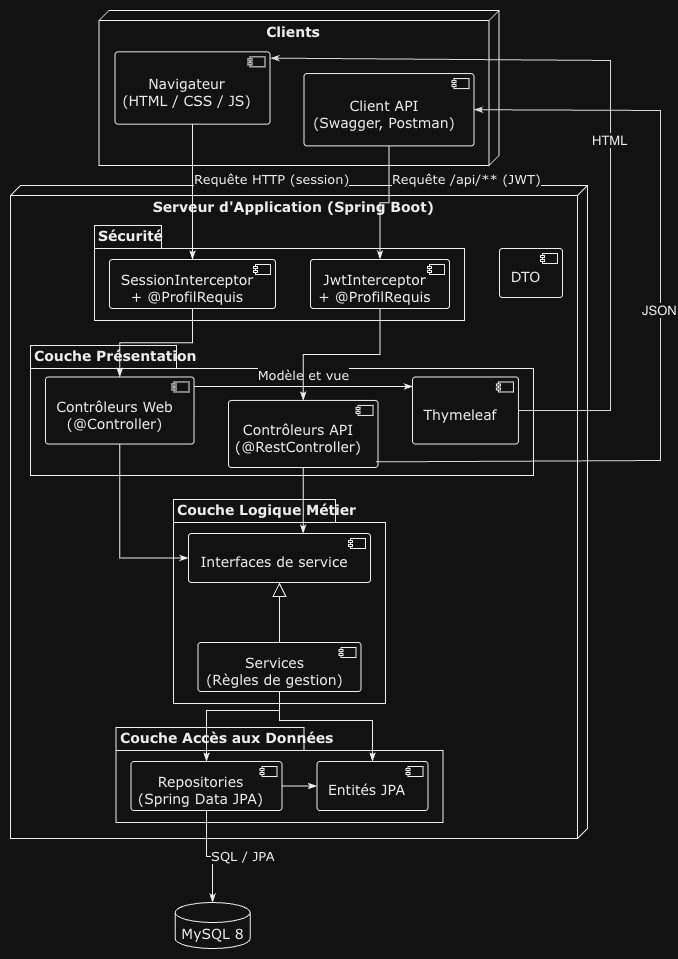
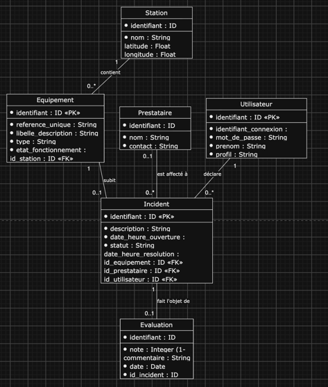

# Journal — Opsis (ALTN72, 2026-27)

**Groupe :** Thomas GUIBERT, Roméo FROGER

## README
Prérequis : Java 25 et Docker démarré.

```bash
cp .env.example .env      # une seule fois : configuration locale, non versionnée
docker compose up -d      # MySQL (port 3307, schéma et données de bdd.sql) + Adminer (http://localhost:8081)
sh mvnw spring-boot:run   # l'application lit seule le fichier .env
```

Puis ouvrir http://localhost:8080. Application déployée : https://...

| Identifiant | Profil | Mot de passe |
|:--|:--|:--|
| `responsable.test` | Responsable d'exploitation | `1234` |
| `agent.test` | Agent | `1234` |
| `technicien.test` | Technicien | `1234` |

Repartir d'une base propre : `docker compose down -v && docker compose up -d`.

En cas de problème :
- `Port 8080 was already in use` : une ancienne instance tourne encore (`lsof -ti:8080`, puis `kill <PID>`).
- `Could not resolve placeholder` : le `.env` manque, ou l'application n'est pas lancée depuis la racine du projet.
- `Access denied` ou `Unknown column` : la base a été créée avec d'anciennes valeurs ou un ancien `bdd.sql`. La recréer.

Déploiement sur Railway (image construite par le `Dockerfile`) :
1. Créer un projet relié au dépôt et lui ajouter une base MySQL.
2. Renseigner `DB_HOST`, `DB_PORT`, `MYSQL_USER`, `MYSQL_PASSWORD`, `MYSQL_DATABASE=Base_ALTN72` et un nouveau `JWT_SECRET` (`openssl rand -base64 32`).
3. Charger `bdd.sql` une seule fois, car il efface les tables.
4. Désactiver le compte `admin`, dont le mot de passe est public.

Limites connues :
- Les dates de démonstration sont relatives au chargement de la base et vieillissent ensuite : l'incident à 47 h devient orange au bout d'une heure. Recréer la base avant une démonstration.
- Un compte modifié ou supprimé garde sa session (30 min) ou son JWT (7 jours) jusqu'à expiration : le profil n'est relu qu'à la connexion.
- Plus aucun secret n'est versionné, mais d'anciens mots de passe de base locale et une ancienne clé JWT restent lisibles dans l'historique Git. Ils ne doivent servir à aucun déploiement.
- Les formulaires n'ont pas de jeton CSRF, le projet n'utilisant pas Spring Security.
- L'état d'un équipement n'a pas de verrou optimiste : deux incidents du même équipement traités au même instant pourraient le laisser à recalculer.

## ARCHITECTURE
Dépôt : https://github.com/Carrybou/Opsis

| Package | Responsabilité |
|:--|:--|
| `controller.web` / `controller.api` | Pages Thymeleaf (session) / API REST sous `/api/**` (JWT) |
| `service` | Règles métier, exposées par des interfaces |
| `model` | Entités JPA et repositories, par domaine |
| `dto` | Objets échangés avec les vues et l'API |
| `exception` | Exceptions métier par type d'erreur, et leur traitement (`gestion`) |
| `security` | Intercepteurs, contrôle des profils (`@ProfilRequis`) |
| `config` | Intercepteurs, horloge, beans de sécurité, OpenAPI |





## TESTS
Stratégie : peu de tests, ciblés sur ce qui casserait l'application. Chaque règle de gestion une fois, le refus par profil des routes protégées, le cas nominal de chaque action, un exemple de chaque code d'erreur.

- `sh mvnw test` : tests unitaires et de contrôleurs, sans base ni Docker (90 tests).
- `sh mvnw verify` : ajoute les tests sur vrai MySQL par Testcontainers, Docker requis (21 tests), et le rapport JaCoCo dans `target/site/jacoco/index.html`.
- Résultat : 111 tests au vert, 88 % des lignes et 71 % des branches couvertes.

Couvert :
- **RG3 / RG4** : bornes exactes à 47 h, 48 h et 72 h, avec une horloge fixe ; un incident affecté n'a jamais de couleur.
- **RG1, RG2, RG5, RG7, RG8, RG11** : `ParcoursIncidentIT` déroule la vie d'un incident avec de vrais comptes et tokens, et l'état de l'équipement à chaque étape.
- **RG6, RG7, RG8, RG9 et requête native** : `RepositoriesIT`, sur le vrai schéma et ses contraintes.
- **RG10** : `EcrituresSimultaneesIT`, une écriture périmée échoue entièrement.
- **F1 à F11** : services avec Mockito, contrôleurs avec `@WebMvcTest` et templates réellement rendus.
- **F12** : 200, 201, 400, 401, 403, 404, 409, liste des incidents actifs, documentation Swagger.

Non couvert : le JavaScript (carte, tableau de bord), vérifié à la main dans le navigateur ; une partie de la gestion des comptes (`UtilisateurService` : 45 % des lignes).

## CHOIX TECHNIQUES
### Droits par profil

Le sujet prévoit deux profils ; nous en avons ajouté un troisième, le technicien, qui intervient sur le terrain.

| N° | Fonctionnalité | Responsable d'exploitation | Agent | Technicien |
|:--|:--|:--|:--|:--|
| F2–F3 | Consulter équipements et fiches | Lecture seule | Lecture seule | Lecture seule |
| F4 | Déclarer un incident | Accès complet | Accès complet | Interdit |
| F5 | Consulter un incident | Lecture seule | Lecture seule | Lecture seule |
| F6 | Modifier un incident | Tout incident non résolu | Ses incidents, tant qu'ils ne sont ni affectés ni résolus | Interdit |
| F7 | Affecter ou réaffecter un prestataire | Accès complet | Lecture seule | Lecture seule |
| F8 | Déclarer un incident résolu | Accès complet | Interdit | Accès complet |
| F9 | Consulter l'historique | Lecture seule | Lecture seule | Lecture seule |
| F10 | Évaluer un prestataire | Accès complet | Lecture seule | Lecture seule |
| F11 | Tableau de bord | Accès complet | Interdit | Interdit |
| Alpha | Carte du réseau | Lecture seule | Lecture seule | Lecture seule |
| — | Gestion des comptes | Accès complet | Interdit | Interdit |

L'API (F12) applique les mêmes droits. Ses lectures, dont la liste des incidents actifs, sont ouvertes à tout profil connecté : le tableau de bord reste réservé au responsable, mais ces incidents sont déjà visibles par tous sur les fiches. Le technicien n'évalue pas, pour ne pas noter son propre travail. Un responsable ne peut ni supprimer son propre compte ni changer son propre profil.

Double contrôle (RG11) : `@ProfilRequis` filtre la route, puis le service vérifie ce qui dépend de l'incident (auteur, affectation, statut). Les vues masquent les boutons selon `Droit` et ces mêmes règles, mais la sécurité reste côté serveur.

### Choix métier
- **F6** : seule la description est modifiable. Un incident résolu n'est plus modifiable par personne (RG5).
- **État de l'équipement** (le sujet n'impose pas de règle) : `EN_MAINTENANCE` s'il a un incident affecté, sinon `EN_PANNE` s'il a un incident non affecté, sinon `FONCTIONNEL`. La règle est la même à la déclaration, à l'affectation et à la résolution.
- **Niveau d'attention** : calculé dans `NiveauAttention` à partir d'un `Clock` injecté, jamais stocké. Les seuils de 48 h et 72 h n'existent qu'à cet endroit.
- **Note d'un prestataire** : visible dans l'historique, sur la fiche prestataire et dans la liste d'affectation.
- **Suppression d'un compte** : c'est une désactivation, car la clé étrangère supprimerait sinon ses incidents.
- **Graphiques** : rendus côté serveur en HTML et SVG, sans bibliothèque. Le service produit les comptages, le DTO en déduit les pourcentages et le tracé.
- **API** (F12) : liste des actifs, détail, historique, déclaration, modification, affectation, résolution, évaluation. Documentée sur `/swagger-ui.html`, après connexion au site ; le jeton s'obtient par `POST /api/auth/login`.

### Exceptions : @ControllerAdvice
Les exceptions métier sont personnalisées, en français, et héritent d'une classe mère par type d'erreur. `ApiExceptionHandler` les traduit en JSON (`ApiError`), `VueExceptionHandler` en page lisible, sans trace technique.

| Code | Cas |
|:--|:--|
| 400 | donnée invalide (`@Valid`), note non entière, identifiant mal formé |
| 401 | API sans token ou token invalide, identifiants incorrects |
| 403 | profil non autorisé, règle de modification non respectée |
| 404 | ressource inexistante (`RessourceIntrouvableException` et ses filles) |
| 409 | état incompatible : déjà résolu, déjà évalué, affectation impossible, modification simultanée |

Nous n'avons pas retenu `ResponseStatusException` : chaque service devrait choisir son code HTTP, ce qui lierait le métier au web. `ResponseEntity` ne sert que dans l'advice et pour les créations (201 avec `Location`).

### SOLID
- **S, appliqué** : contrôleurs web et REST séparés, un service par domaine. L'évaluation a ainsi son propre service plutôt que d'alourdir `IncidentService`.
- **O, appliqué** : les advices traitent `RessourceIntrouvableException`. `StationIntrouvableException` a été ajoutée sans toucher aux handlers.
- **D, appliqué** : les contrôleurs dépendent d'interfaces injectées par constructeur, ce qui permet de les tester avec des services simulés. Exception assumée : `JwtService`, composant technique sans règle métier.
- **L, respecté sans avoir guidé la conception** : la seule hiérarchie est celle des exceptions, dont les filles ne font que préciser le message.
- **I, non appliqué par choix** : `IncidentInterface` compte 10 méthodes alors que `EquipementViewController` n'en utilise qu'une. La découper multiplierait les interfaces pour une seule implémentation et des clients du même projet, modifiés en même temps.

### Requête SQL native
`EvaluationRepository.calculerNotesParPrestataire` : moyenne et nombre d'évaluations par prestataire.

Analyse critique : le gain vient de l'agrégation en base, pas du SQL natif. La même requête s'écrirait en JPQL, et elle est native parce que le sujet en demande une. Elle cite des tables et des colonnes : une erreur de nom n'apparaîtrait qu'à l'exécution, alors que Spring Data valide le JPQL au démarrage. Son résultat dépend aussi des types de la base, d'où une projection en `Number`. Nous l'avons isolée à un seul endroit et `RepositoriesIT` la vérifie sur MySQL. Sans la consigne, elle serait en JPQL.

### @Transactional
- `IncidentService.declarer`, `affecter`, `resoudre` : incident et état de l'équipement sont enregistrés ensemble ou pas du tout (RG10).
- `IncidentService.modifier`, `UtilisateurService.modifier` et `supprimer` : l'entité chargée reste suivie, donc enregistrée en fin de méthode.
- `EvaluationService.evaluer` : la vérification « pas encore évalué » et l'insertion sont dans la même transaction.
- Lectures en `readOnly = true`, pour que les relations paresseuses restent accessibles sans écriture.
- `@Version` sur `Incident` : une écriture simultanée reçoit un 409 au lieu d'écraser la première.

## LOT ALPHA
### Fonctionnalité transverse 1 : cartographie du réseau
- **Besoin** : voir d'un coup d'œil la situation du réseau et ouvrir depuis la carte les équipements et incidents d'une station.
- **Choix** : page `/carte`, avec Leaflet et OpenStreetMap, sans clé d'API. Thymeleaf rend la liste des stations et `carte.js` en crée les marqueurs : pas de route JSON à ajouter, et la liste reste utilisable sans JavaScript.
- **Ce qui fonctionne** : marqueurs colorés selon l'équipement le plus grave, légende, panneau latéral, navigation au clavier, mobile. Testé par `CarteServiceTest` et `CarteViewControllerTest`.
- **Difficultés** : une carte créée dans un cadre sans taille se cadre mal (résolu par un `ResizeObserver`) ; les étiquettes se recouvraient (masquées jusqu'au zoom).
- **Reste à faire** : la carte exige Internet ; le tracé des lignes n'est pas dans le modèle.

### Fonctionnalité transverse 2 : qualité renforcée
- **Besoin** : les tests simulés ne pouvaient prouver ni les requêtes, ni les contraintes, ni les transactions.
- **Choix** : Testcontainers plutôt que H2, pour tester `bdd.sql` sur le même MySQL 8 qu'en vrai ; Failsafe pour garder `mvn test` rapide ; JaCoCo sans seuil bloquant, pour repérer les manques sans écrire de tests sans valeur ; GitHub Actions à chaque push.
- **Ce qui fonctionne** : 21 tests sur vrai MySQL, rapport de couverture, intégration continue. Ces tests ont révélé des défauts que les simulations ne voyaient pas, comme la note décimale tronquée et les écritures simultanées.
- **Difficultés** : un test d'écritures simultanées restait bloqué sur un verrou de ligne, à cause du flush automatique ; le scénario a été réordonné. Certains tests dépendent des données de `bdd.sql`.
- **Reste à faire** : couvrir davantage la gestion des comptes.

Le tableau de bord va aussi au-delà de F11 (pistes 1 et 2) : recherche, filtres combinables partageables par l'URL, graphiques d'âge, de charge par station et d'évolution sur 30 jours, échéance avant le seuil suivant.

## BILAN
### Contribution de chacun
Le projet part du corrigé du TP 5..

- **Thomas** : initialisation, MCD et architecture ; F2, F3, F6, F7, F10, F11 ; gestion des comptes ; premiers tests.
- **Roméo** : base de données et Docker ; F1 (JWT, session, profils), F4, F5, F8, F9, F12 ; lot alpha ; vérification des règles et du §7.

### Plus grande difficulté
La sécurité : faire cohabiter une session pour les pages et un JWT pour l'API, sans Spring Security. Nous avons écrit `JwtService` et deux intercepteurs, qui passent par le même `ControleProfil`. Une relecture route par route, confrontée au sujet, a révélé des failles invisibles à l'écran : `POST /api/utilisateurs` laissait un agent se créer un compte responsable, et le `.env` était versionné. Ces cas sont désormais testés, et les secrets lus dans l'environnement.

### Fonctionnalités non réalisées
- **Rattachement des techniciens aux prestataires** : il demandait une nouvelle relation et de nouvelles règles de droits, et nous avons manqué de temps. N'importe quel technicien peut donc résoudre n'importe quel incident.

### Trois points à retenir
1. **Un droit se vérifie côté serveur** : la faille la plus grave se trouvait sur une route qu'aucune page n'utilisait.
2. **Un test ne prouve que ce qu'il exécute vraiment** : seuls les tests sur vrai MySQL ont couvert les requêtes, les contraintes et les écritures simultanées.
3. **Une bonne architecture se voit quand on la modifie** : la séparation des couches nous a permis de réorganiser le code en gardant les tests verts. À l'inverse, un secret commité reste dans l'historique : il vaut mieux se poser la question dès le début.
