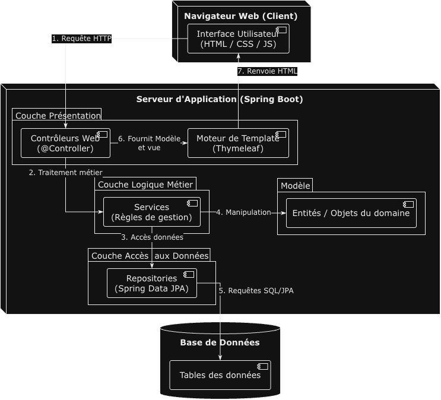
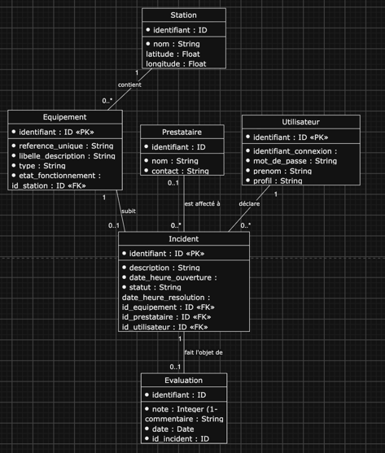

# Journal — Opsis (ALTN72, 2026-27)

**Groupe :** Thomas GUIBERT, Roméo FROGER

## LANCER L'APPLICATION EN 3 COMMANDES
Prérequis : Java 25, Docker Desktop démarré, et un fichier `.env` à la racine (voir le tableau du README ci-dessous).

```bash
docker compose up -d                      # 1. base MySQL (port 3307) + Adminer (http://localhost:8081)
set -a; source .env; set +a               # 2. charge les variables (JWT_SECRET, identifiants MySQL)
sh mvnw spring-boot:run                   # 3. lance l'application
```

Ouvrir ensuite http://localhost:8080 et se connecter (ex. `thomas` / `1234`, profil responsable d'exploitation).

En cas de problème :
- **`Port 8080 was already in use`** : une ancienne instance tourne encore. `lsof -ti:8080` donne son PID, puis `kill <PID>`.
- **`Unable to determine Dialect without JDBC metadata`** : l'application ne joint pas MySQL. Vérifier que le conteneur tourne (`docker ps`). Pour utiliser un MySQL local sur un autre port : `DB_PORT=3306 sh mvnw spring-boot:run`.
- **Erreur sur `jwt.secret`** : le `.env` n'a pas été chargé (étape 2), ou VS Code / IntelliJ lance l'application sans lui. Il faut alors ajouter le `.env` dans la configuration de lancement de l'IDE.
- **Repartir d'une base propre** : `docker compose down -v && docker compose up -d`.

## README
- Prérequis : Java 25, Maven 3.9+, Docker (Docker Desktop ou Docker Engine + Compose).
- Configuration : créer un fichier `.env` à la racine (non versionné) contenant :

  | Variable              | Rôle                                                        |
  |:----------------------|:------------------------------------------------------------|
  | `MYSQL_ROOT_PASSWORD` | Mot de passe root du conteneur MySQL                        |
  | `MYSQL_DATABASE`      | `Base_ALTN72`                                               |
  | `MYSQL_USER`          | Utilisateur applicatif de la base                           |
  | `MYSQL_PASSWORD`      | Mot de passe de cet utilisateur                             |
  | `JWT_SECRET`          | Clé de signature des JWT de l'API (32 caractères minimum)   |

- Initialiser la base : `docker compose up -d`
  - MySQL 8 est exposé sur le port **3307**, Adminer sur http://localhost:8081. Le port utilisé par l'application vaut 3307 par défaut et se change avec la variable `DB_PORT`.
  - `bdd.sql` (schéma + données de démonstration) n'est joué qu'à la première création du volume. Pour repartir d'une base propre : `docker compose down -v && docker compose up -d`.
- Lancer (en chargeant `.env`, nécessaire pour `JWT_SECRET`) :
  ```bash
  set -a; source .env; set +a
  mvn spring-boot:run
  ```
  L'application est alors disponible sur http://localhost:8080 (redirection vers `/login` si non connecté).
- Application déployée : https://...
- Comptes de test : ...
- Limites connues :
  - Les dates des incidents de démonstration sont figées dans `bdd.sql` ; elles devront être générées relativement à l'instant présent (§4).
  - Les identifiants de la base sont encore écrits dans `application.properties` au lieu d'être lus depuis les variables d'environnement (§7.7).

## ARCHITECTURE
- Dépôt : https://github.com/Carrybou/Opsis
- Découpage en packages (`altn72.opsis`) :

  | Package            | Responsabilité                                                                  |
  |:-------------------|:--------------------------------------------------------------------------------|
  | `controller.web`   | Contrôleurs Thymeleaf (session HTTP), gestion des erreurs côté pages            |
  | `controller.api`   | Contrôleurs REST sous `/api/**` (authentification JWT)                          |
  | `service`          | Règles métier, exposées par des interfaces (`EquipementInterface`…)            |
  | `model`            | Entités JPA et repositories Spring Data, regroupés par domaine                  |
  | `dto`              | Objets échangés avec les vues et l'API (records)                                |
  | `exception`        | Exceptions métier et `@RestControllerAdvice` de l'API                           |
  | `security`         | Intercepteurs session / JWT, contrôle des profils (`@ProfilRequis`)             |
  | `config`           | Enregistrement des intercepteurs, beans de sécurité                             |

### Schéma  


### MCD

## TESTS
- Stratégie :
  - Tests unitaires des services avec JUnit 5 + Mockito (repositories simulés, aucune base nécessaire), pour vérifier les règles métier isolément.
  - Tests des contrôleurs web avec `@WebMvcTest` + MockMvc : seule la couche web est chargée (contrôleurs, advices, intercepteurs), les dépendances sont remplacées par des `@MockitoBean`. Les templates Thymeleaf sont réellement rendus, ce qui permet de vérifier le contenu affiché.
  - Un test `@SpringBootTest` vérifie que le contexte complet démarre.
- Commande : `mvn verify` (charger `.env` et lancer la base au préalable : `OpsisApplicationTests` démarre le contexte complet).
- Couvert :
  - F1 (`AuthServiceTest`) : identifiants valides, mot de passe incorrect, identifiant inconnu (même message dans les deux cas pour ne pas révéler les identifiants existants), comparaison au hash BCrypt.
  - F1 (`LoginViewControllerTest`) : affichage du formulaire, ouverture de la session après connexion, réaffichage de la même page avec le message d'erreur et l'identifiant saisi, redirection si déjà connecté, déconnexion (session invalidée, retour à la page de connexion avec message).
  - F1 / F2 / RG11 (`StationViewControllerTest`) : page protégée sans session → redirection vers `/login` ; en-tête « Bonjour [Prénom] ([profil]) | Déconnectez-vous » ; équipements regroupés par station avec type, état et lien vers la fiche ; indicateurs de synthèse ; station sans équipement ; `/` redirige vers les stations.
  - F3 / RG7 (`EquipementServiceTest`) : séparation incidents en cours / passés avec conservation de l'ordre par date d'ouverture, équipement sans incident, équipement inexistant → `EquipementIntrouvableException`.
  - F6 / RG5 (`IncidentServiceTest`) : le responsable modifie tout incident non résolu, même affecté ; l'agent ne modifie que les incidents qu'il a déclarés et qui ne sont pas encore affectés ; refus pour un autre agent, pour un technicien et pour un incident résolu (même pour le responsable), avec à chaque fois le motif affiché ; incident inexistant ; `incidentsModifiables` et `estModifiable` appliquent les mêmes règles.
  - Droits par profil, pages web :
    - `EquipementViewControllerTest` : sur la fiche équipement, seul l'agent voit « Déclarer un incident » ; le lien « Modifier » n'apparaît que sur les incidents autorisés pour le profil connecté ; le technicien ne voit ni l'un ni l'autre.
    - `IncidentViewControllerTest` : page détail redirigée vers `/login` sans session ; bouton « Modifier » et formulaire présents seulement si l'incident est modifiable ; `?modifier=true` ouvre le formulaire ; enregistrement → retour sur la page détail avec message ; description invalide → page détail réaffichée avec le formulaire ouvert et l'erreur ; 403 pour un technicien ou en cas de règle métier non respectée ; déclaration refusée au responsable et au technicien (affichage du formulaire et envoi).
  - Droits par profil, API (`IncidentRestControllerTest`, token JWT simulé par profil) :
    - `GET /api/incidents/{id}` : 401 sans token, 200 pour tout profil connecté, 404 si l'incident n'existe pas.
    - `POST /api/incidents` : 403 pour le responsable, 201 pour l'agent.
    - `PATCH /api/incidents/{id}` : 403 pour le technicien, 200 pour le responsable, 403 avec le motif quand une règle métier refuse, 400 si la description est invalide.
- Résultat : 52 tests, tous verts (`mvn test`, base démarrée et `.env` chargé).
- Non couvert : repositories (`@DataJpaTest`) et contrôleurs REST des stations / équipements, prévus dans le lot alpha « Qualité renforcée » ; règles RG1 à RG4 et RG8 non encore implémentées.

## CHOIX TECHNIQUES
- Droits par profil :
- | N°    |            Fonctionnalité             | Profil 1: Responsable d’exploitation | Profil 2: Agent |
  |:------|:-------------------------------------:|-------------------------------------:|----------------:|
  | F2–F3 |    Consulter équipements et fiches    |                                  OUI |             OUI |
  | F4    |         Déclarer un incident          |                                  NON |             OUI |
  | F5–F6 |   Consulter / modifier un incident    |                                  OUI |   PARTIELLEMENT |
  | F7    | Affecter ou réaffecter un prestataire |                                  OUI |             NON |
  | F8    |      Déclarer un incident résolu      |                                  OUI |             NON |
  | F9    |        Consulter l’historique         |                                  ... |             ... |
  | F10   |        Évaluer un prestataire         |                                  OUI |             NON |
  | F11   |            Tableau de bord            |                                  OUI |             NON |

  - F6 « partiellement » pour l'agent : il ne modifie que les incidents qu'il a déclarés, tant qu'aucun prestataire n'est affecté. Un incident résolu n'est plus modifiable par personne (RG5).
  - Double contrôle : `@ProfilRequis` filtre la route selon le profil (intercepteur session ou JWT), puis le service vérifie les règles qui dépendent de l'incident (auteur, affectation, statut) et lève `ModificationIncidentInterditeException` (403) avec le motif. Les vues n'affichent le bouton « Modifier » que si `estModifiable` le permet ; elles s'appuient donc sur la même règle que le service.
- Modification d'un incident (F5 + F6) : édition directement sur la page détail plutôt que sur une page séparée. Le bouton « Modifier » remplace la description par un champ prérempli, avec un compteur de caractères et les boutons Annuler / Enregistrer. L'enregistrement fait un `PUT /incidents/{id}` (champ caché `_method`) et revient sur la même page avec un message de confirmation ; en cas d'erreur de validation, la page se réaffiche avec le champ ouvert. Sans JavaScript, le bouton reste un lien `?modifier=true` qui ouvre le formulaire côté serveur.

- Exceptions : **@ControllerAdvice**.
  - Les exceptions métier sont personnalisées, avec un message en français, et héritent d'une classe mère par type d'erreur (`RessourceIntrouvableException` → `EquipementIntrouvableException`…).
  - Deux advices distincts, ciblés par `basePackages` : `ApiExceptionHandler` (`controller.api`) traduit l'erreur en JSON `ApiError` avec le bon code HTTP ; `VueExceptionHandler` (`controller.web`) affiche la page `erreur.html` avec un message lisible, sans trace technique.
  - Pourquoi pas `ResponseStatusException` : elle obligerait chaque contrôleur ou service à choisir le code HTTP lui-même et lierait la couche métier au web. Avec un advice, le service lève une exception métier, et la traduction HTTP est faite à un seul endroit, différemment pour l'API et pour les pages.
  - `ResponseEntity` est utilisé dans l'advice de l'API pour fixer à la fois le code HTTP et le corps `ApiError`.
- SOLID :
  - **S — Responsabilité unique** : contrôleurs web et REST séparés (`StationViewController`, `EquipementViewController` / `EquipementRestController`…) ; les contrôleurs délèguent au service, qui porte la règle métier (ex. séparation des incidents en cours / passés dans `EquipementService`).
  - **D — Inversion des dépendances** : les contrôleurs dépendent des interfaces de service (`EquipementInterface`, `UtilisateurInterface`, `AuthInterface`), injectées par constructeur. Concrètement, le même service sert la vue et l'API, et les services se testent avec des repositories simulés.
  - **O — Ouvert/fermé** : les advices traitent `RessourceIntrouvableException` ; une nouvelle ressource introuvable (incident, prestataire…) produit un 404 sans modifier les handlers.
  - L, I : ...
- Requête SQL native : ...
- @Transactional (dans `IncidentService`) :
  - `declarer` : la création de l'incident et le passage de l'équipement à « en panne » sont enregistrés ensemble ou pas du tout.
  - `modifier` : l'incident chargé reste suivi par JPA, donc la nouvelle description est enregistrée à la fin de la méthode sans `save` explicite.
  - Les lectures (`consulterDetail`, `estModifiable`, `incidentsModifiables`) sont en `readOnly = true`.

## LOT ALPHA
### Fonctionnalité transverse 1 : Cartographie du réseau
- Besoin · périmètre envisagé · choix et essais · ce qui fonctionne · difficultés · reste à faire
### Fonctionnalité transverse 2 : Qualité renforcée

## BILAN
- Contribution de chacun : ...
- Plus grande difficulté et comment elle a été surmontée : ...
- Fonctionnalités non réalisées et pourquoi : ...
- Trois points à retenir du cours et du projet : ...